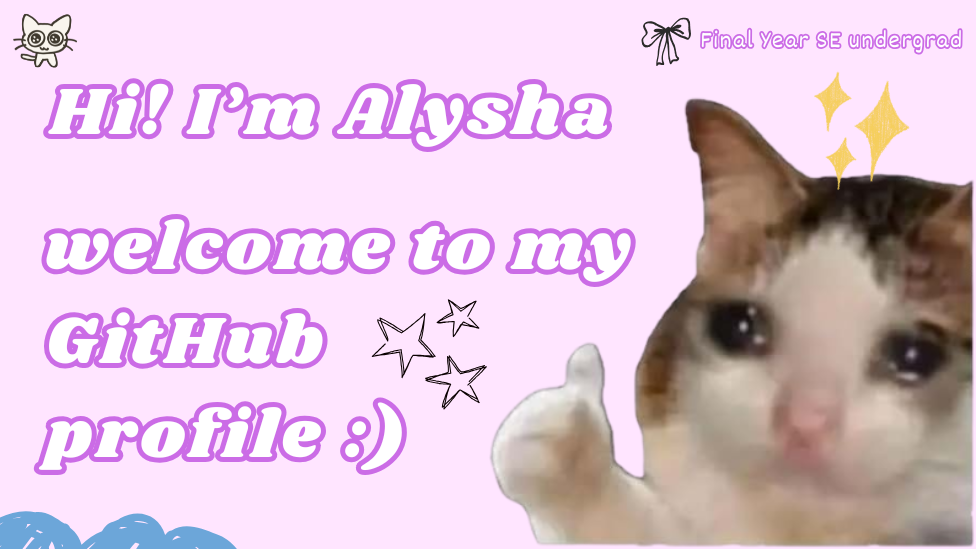

<!--
**alysha2803/alysha2803** is a ✨ _special_ ✨ repository because its `README.md` (this file) appears on your GitHub profile.

Here are some ideas to get you started:

- 🔭 I’m currently working on ...
- 🌱 I’m currently learning ...
- 👯 I’m looking to collaborate on ...
- 🤔 I’m looking for help with ...
- 💬 Ask me about ...
- 📫 How to reach me: ...
- 😄 Pronouns: ...
- ⚡ Fun fact: ...
-->

# Introduction
Hi! I'm Alysha, a final year SE undergraduate. I enjoy doing mobile app development and security, but always open to new areas to learn. 

- ❤️ **Hobby**: I play Roblox and my miniatures when I'm not doing CS related stuff :3
- 📖 **Course expectations**: For this semester, I am taking the Software Maintenance and Evolution course. I am expecting to learn about practices after deploying/delivering a software, what can we do to ensure its scalability, organisation of update management in the future, including how to make it stay relevant to the users.

- 🔗 **Let's Connect!**
 https://www.linkedin.com/in/alyshahannani/
